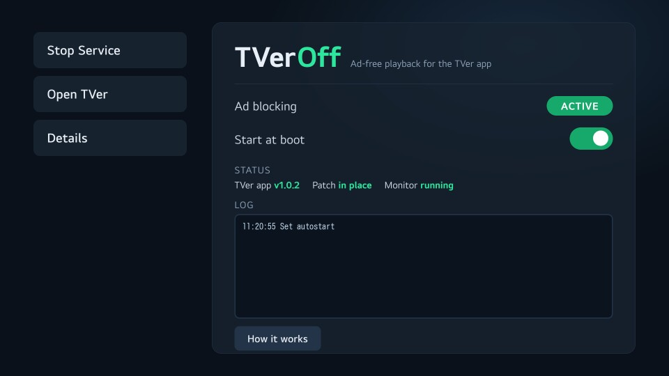
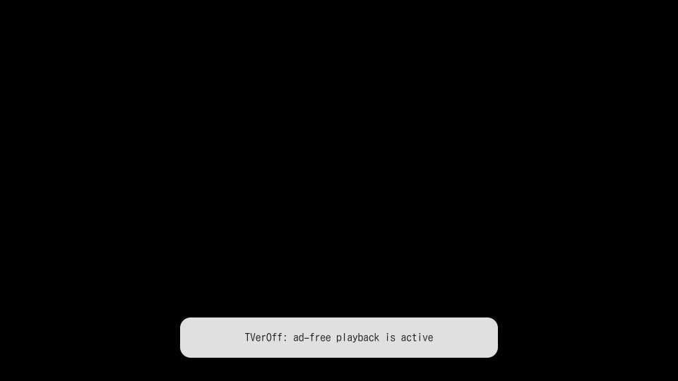

# TVerOff

Ad-free playback for the **stock TVer app** on rooted LG webOS TVs. The same idea as
[AmazOff](https://github.com/azoffshowy/AmazOff) for Prime Video: an installable app (IPK) with a **Start/Stop service**
switch and **start at boot**, while TVer itself stays untouched and keeps auto-updating. Every way of launching TVer
(including the remote's button) keeps working, because the real TVer app is still the app.

<p>
  
  
</p>

## How it works, in four lines

1. TVer's TV app is just a loader: all of its code is served from `https://webapp.tver.jp/` into webOS's browser.
2. Its commercials are stitched into the video **by TVer's servers** (STREAKS SSAI). The player asks for that stream with
   `ssai=1`; TVer's own home-screen previews ask for the plain stream with `ssai=0`, and the backend serves it.
3. webOS automatically loads `<app folder>/webOSUserScripts/userScript.js` into the pages of that app. TVerOff puts one
   small file there that makes the playback request ask for `ssai=0`.
4. Stop Service deletes the file. Nothing else on the TV is modified: no proxy, no certificates, no DNS or hosts
   changes, no system files.

Measured on the test TV with the same episode: stock = `ssai-manifest` + SSAI session + ad-break beacons + a 15 s
pre-roll; TVerOff = plain manifest, none of those, programme starts immediately. Details and evidence:
[`development/NOTES.md`](development/NOTES.md).

## Requirements

* A rooted LG webOS TV ([webosbrew](https://www.webosbrew.org/), [cani.rootmy.tv](https://cani.rootmy.tv)) with
  **Homebrew Channel** (the app talks to its `exec` service; boot autostart uses its `init.d` hook).
* The **TVer** app installed from the LG Content Store.
* Verified on: LG OLED55C2PJA, webOS 11.2.0, Homebrew Channel 0.7.3, TVer app 1.0.2 (web build 7.0.15).

## Install

Build it (see [Building](#building)) or use `dist/com.tveroff.patcher_0.1.0_all.ipk`, then install with any of:

* **Dev Manager** ([webosbrew/dev-manager-desktop](https://github.com/webosbrew/dev-manager-desktop)): add the TV, "Apps",
  install IPK. (On webOS 11 prefer this over Homebrew Channel's own install button; see the guide, section 6.)
* **`ares-install`**: `ares-install -d <tv> dist/com.tveroff.patcher_0.1.0_all.ipk`
* **SSH** (what was used for testing; `pip install paramiko`): `set TV_HOST=<tv ip>` then
  `python development/tvlink.py install dist/com.tveroff.patcher_0.1.0_all.ipk`
  (copies the IPK to the TV and calls `luna://com.webos.appInstallService/dev/install`, the call Homebrew Channel makes).

The **TVerOff** tile appears in the launcher.

## Use

1. Open **TVerOff**, choose **Start Service**. The pill turns **ACTIVE**. If TVer was running it is closed so that it
   loads the patch on its next start.
2. Switch **Start at boot** on if you want it to survive reboots (an `init.d` entry, same mechanism as AmazOff).
3. **Open TVer** and play something. A small green badge *TVerOff ✓ 広告なし / ad-free* shows for three seconds when
   playback starts, and a toast confirms when TVer opens. The programme starts without commercials.
4. **Details** shows the state (TVer version, patch in place, monitor) and the log.

Over SSH the same thing is `…/com.tveroff.patcher/tools/tverctl.sh start|stop|status|autostart_toggle`.
Logs live in `/var/lib/webosbrew/tveroff/` and survive reboots, so you can read what the boot hook did afterwards.

<p></p>

**After a TVer update** (LG's store replaces TVer's folder, and the file with it): just open TVer once. The monitor
notices, puts the file back and restarts TVer one time. At boot the same repair happens through autostart.

## Uninstall

1. In TVerOff: **Stop Service** (removes the file from TVer's folder), and switch **Start at boot** off.
2. Remove the app (Dev Manager, or `luna-send -n 1 luna://com.webos.appInstallService/dev/remove '{"id":"com.tveroff.patcher"}'`).

Removed the app while the service was running? The monitor notices that its files are gone (the next time anything
changes on the TV's screen, after a 30 s grace period so that an upgrade-in-place is not mistaken for an uninstall) and
removes the patch and the autostart entry by itself; a small log directory remains under `/var/lib/webosbrew/tveroff/`
(delete it too if you like). If the service was not running, clean up by hand:
`rm -rf /media/cryptofs/apps/usr/palm/applications/jp.co.tver.tvapp/webOSUserScripts /var/lib/webosbrew/init.d/50-custom-tveroff /var/lib/webosbrew/tveroff`

## Troubleshooting

| symptom | what to do |
|---|---|
| UI shows ERROR and *"Homebrew Channel refused the call"* | On some webOS 11 builds Homebrew Channel 0.7.x denies `exec` to other apps. Update Homebrew Channel to 0.8.0+ or apply the fix in the guide (section 3.5). Start at boot and SSH control work regardless. (It worked without this on the test TV.) |
| a **red** badge *ads not blocked* | TVer changed something and an ad-stitched stream got through. Run `python development/smoke_test.py` and see `development/NOTES.md` section 5. |
| still ads right after Start | TVer must be restarted to load the patch; Start does that, but if you opened TVer in between, close it and open it again. |
| status says *outdated* | You installed a newer TVerOff over an older patch: press **Start Service**. |
| nothing at all changes | `tverctl.sh status` must say *patch: installed, up to date*. If not, press Start. If so, a webOS update may have changed the hook (NOTES.md, section 5.4). |

## What it does *not* do

* **Live streams** are left alone (their "commercial breaks" are the broadcaster's own).
* The **"PR" promo cards** on the home screen and the home page's own ad request are not touched: they are not video
  ads inside the player.
* An episode you started *with* ads and resume *without* may resume up to the length of the skipped commercials
  off (TVer stores the playhead of the stitched stream).
* TVer's **own survey** is not touched: after a number of plays TVer asks a 3-step survey (gender, viewing environment)
  before playing, until it has been answered once with the remote. That is TVer's prompt, unrelated to TVerOff, and no
  patch can or should answer it for you.
* It depends on TVer continuing to honour `ssai=0`. If it stops, the red badge says so; see NOTES.md for the fallback.
* It does not touch Prime Video or anything else. AmazOff and TVerOff coexist; they share nothing but Homebrew Channel's
  `init.d` directory.

The script that runs inside TVer's pages is ~180 lines (`src/payload/userScript.js`). It wraps three browser APIs
(`XMLHttpRequest.open`, `fetch`, `URLSearchParams`), makes no network requests of its own and reads no cookies or storage.

## Building

On Linux, or WSL on Windows (the guide's section 5 explains why not Windows): needs `node`, `ar`, `tar` and
`ares-package` (`npm i -g @webos-tools/cli`).

```sh
sh build/build-ipk.sh          # WSL:  wsl -d Alpine -- sh /mnt/<drive>/<path>/TVerOff/build/build-ipk.sh
```

It runs the payload tests, builds from a clean LF-normalised copy with explicit file modes, packages with
`ares-package --no-minify`, and then **verifies the IPK itself** (`build/verify-ipk.sh`): exec bits, no CR characters,
`sh -n` on every script, payload byte-identical to the tested source, everything owned by root. Output: `dist/`.

`npm test` (or `node test/userscript.test.js`) runs the payload tests alone: 14 checks in a sandbox with fake
`XMLHttpRequest`/`fetch`/`location`/`navigation`, including an ES5-only lint.

## Layout

```
src/                    the app that is packaged (id com.tveroff.patcher)
  index.html css/ js/   the TV UI (D-pad + Magic Remote), talks to tverctl.sh via Homebrew Channel exec
  tools/tverctl.sh      start | stop | status | autostart_toggle -> prints one JSON state line
  tools/autostart.sh    boot hook, /var/lib/webosbrew/init.d/50-custom-tveroff points here
  tools/lib/            common.sh (paths, patch install/remove, daemonize), monitor.sh (toast + self-heal)
  payload/userScript.js the file that is copied into TVer's folder
build/                  build-ipk.sh, verify-ipk.sh, make-icons.py
test/                   payload tests
development/            NOTES.md (research + how to re-check), tvlink.py (SSH + in-page bridge),
                        smoke_test.py (does the patch still work on live TVer?), lifecycle_test.py (install/upgrade/uninstall)
docs/                   screenshots taken on the TV
PORTING-GUIDE.md        the field notes this port started from
```

## When TVer changes something

TVer re-deploys its web app constantly, which is why TVerOff hooks the *request* instead of patching TVer's files.
After a TVer or webOS update, `python development/smoke_test.py` (needs `pip install paramiko` and `TV_HOST`) plays an
episode muted on the real TV with the installed payload and tells you in about a minute whether it still works.

## Disclaimer

An independent personal tool, not affiliated with TVer, STREAKS or LG. TVer is free to watch because of its
advertising, and blocking it may be against its terms of use. Use it on your own TV, at your own discretion.

## License

MIT — see [LICENSE](LICENSE). AmazOff (which inspired this project) is MIT too, but no AmazOff code is
included here: TVerOff was written from scratch for a completely different interception technique.
